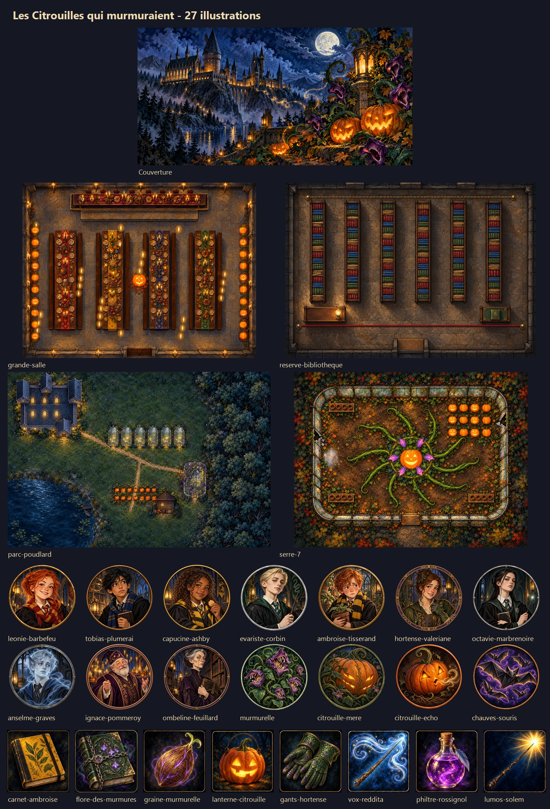

# Les Citrouilles qui murmuraient — finished artwork

All 27 assets in `assets/aventure-citrouilles/` were generated with the built-in `image_gen.imagegen` tool. The prompt set is recorded in [adventure-art-prompts.json](adventure-art-prompts.json). The art uses a non-photorealistic Hogwarts storybook look: painted gouache and ink, amber pumpkin light, midnight blue shadows, emerald foliage, violet whispering flowers and antique metal frames.

| Assets | Format | Export dimensions |
| --- | --- | --- |
| Cover | JPG | 1200 × 600 |
| Great Hall | JPG | 2400 × 1800 |
| Restricted library | JPG | 2000 × 1400 |
| Hogwarts grounds | JPG | 3000 × 2000 |
| Greenhouse 7 | JPG | 2400 × 1800 |
| 14 character and creature tokens | PNG with alpha | 768 × 768 |
| 8 inventory and spell icons | PNG | 512 × 512 |

Maps were repainted using rasterized original schematics as layout references. They retain the arrangement, orientation and approximate footprints of buildings and furniture, including the four house tables, six library shelves, six glasshouses plus the separate seventh, three greenhouse benches and broken-pane entrances. They contain no printed labels, secrets or baked-in gameplay grid. Foundry still supplies the 100 px grid and journal notes. Scene sizes, token sizes, token and note coordinates, lighting and document IDs are unchanged. This is a painted map set rather than a pixel-exact architectural trace; no wall geometry was added or changed.

The schematic generator `tools/generate-adventure-art.cjs` now writes references to `.art-work/adventure-reference/` by default so it cannot replace the finished images. Generate references before editing maps, and preserve the scene dimensions when exporting revisions.

New adventure imports use the JPG/PNG paths through both the adventure source and compiled compendium. Existing imported world documents keep their own paths: re-import the updated adventure (after backing up customized world documents), or change their image paths from `.svg` to `.jpg` for maps/cover and `.png` for tokens/icons.
